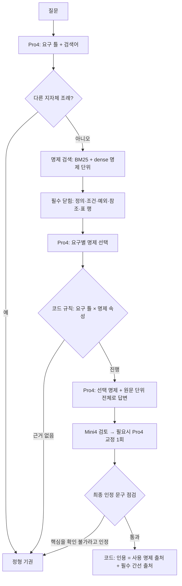

# 명제 기반 필수근거 지식그래프 RAG 설계 (PKG-v1)

작성 2026-11-12 · 상태: 설계안. 교차검증 전이며 구현·성능 미측정.
기반 문서: `handoff_r9/historical_design/20261111-design.md`(BUNDLE-SOLAR-v1), `20261111-contracts.json`.
실측 근거: `claude_impl/RESULTS_449.md`(V6~V8, 449문항), IAO 저장 응답 449개 대조.

---

## 0. 한 줄 요약

고정 6개 조례를 **미리 검수 완료한 명제 그래프**로 만들어 둡니다. 실행할 때는 질문을 요구 틀로 해석한 뒤 **명제를 선택**합니다. 답변 가능 여부의 일부는 **명제 속성과 요구 틀의 대조(코드 규칙)**로 정하고, 답변은 선택 명제와 그 **원문 단위 전체**로 씁니다. 인용은 명제의 출처와 필수 간선으로 코드가 조립합니다.

## 1. 가설과 이 설계가 검증할 것

- **팀 가설**: 법률 QA는 원문 덩어리보다 **명제(독립된 법적 효과) 단위**로 검색·선택·판정할 때 더 정확하다.
- **기존 근거**: 과거 Q32 비교(시간 제외 인용·함정 점수)에서 항 검색 79.03%, 명제 검색 82.26%, 명제+관계 확장 85.48%였습니다. 문항이 32개뿐이라 근거가 약합니다.
- **이번에 확인할 것**: 같은 449문항, 같은 채점기, 같은 운영 조건에서 원문 단위 구현(V8, 주지표 0.899)과 비교해 다음 세 가지가 실제로 개선되는지.
  1. 함정 문항 정확도
  2. 긴 조문의 특정 호 누락
  3. 인용 완전성

## 2. 기존 설계(BUNDLE-SOLAR-v1)에서 유지하는 것

| 유지 원칙 | 기존 문서 위치 |
|---|---|
| 명제 = 문장 요약이 아니라 **독립된 법적 효과 + 그 효과에 필요한 원문 위치** | §5 |
| 분리 순서 6단계(효과 절 → 주체·조건·양태가 다르면 분리 → 양면 함께 → 단서 처리 → 호별 판단 → 불명확하면 항 전체 fallback) | §5 |
| 간선 방향 = 해석할 대상 → 함께 읽어야 할 원문, 역할·범위·검토 상태 필수 | §6.2 |
| 간선 역할 COMMON / EXCEPTION / DEFINITION / REFERENCE / APPLICATION / TABLE_CONTEXT / LEGAL_BASIS | §6.2 |
| 필수 닫힘은 ID 집합으로 종료(홉 수 제한 없음), 외부 참조는 만들어 넣지 않고 표지만 남김 | §6.3 |
| **답변기 전달은 원문 단위 전체**. 명제 문장만 주지 않음 | §5 끝 |
| 표 주석의 물리 범위(attach_range)와 법적 범위(legal_scope) 구분, 값 지위(직접 규정·기준값·범위·위임·미검토) | §4.3 |
| 구축 입력에 정답·점수·문항 ID를 넣지 않음 | §7 |
| 모델은 ID만 고르고 인용·URL·시행일은 코드가 조립. 통신·시간·계약 오류는 기권이 아님 | §11, §14 |

## 3. 바꾸는 것과 이유

| 변경 | 기존 설계 | PKG-v1 | 이유(실측) |
|---|---|---|---|
| 그래프 범위 | 검토 명제 20~22개, 나머지는 원문 fallback | **6개 조례 전체**를 사전 구축·검수(목표 원문 525단위 전부) | 조례 6개 고정이라 런타임 생성이 필요 없음(사용자 확인). 기존 구성은 사실상 원문 검색 |
| 명제 속성 | core/shared/dependent/exceptions/context 구간만 | 구간 + **주체 역할, 양태, 행위·대상, 값과 값 지위, 조건, 예외, 위임처, 외부 법령 의존, 지정 전제** | 449 함정 오답 28건의 원인이 위임, 외부 법령 내용, 주체 불일치, 지정 여부 같은 속성 문제 |
| 검색 단위 | 원문 컨테이너(명제는 max 집계용) | 명제 단위 검색 → 원문 단위 전달 | 원문 단위에서는 긴 조문 안의 호를 모델이 놓침(선택 과유보 32건, 정답은 모두 검색 3위 안). 호 발췌로 32→2건 |
| 선택 대상 | 원문 묶음(B ID) | **명제 ID**(요구별) | 짧은 명제 카드는 같은 입력 크기에 더 많은 후보를 정확히 보여 줌 |
| 답변 가능 판정 | 모델 found=false, Decide, 관측 R2 | **요구 틀 × 명제 속성 코드 규칙**(사전 등록) + 모델 판단 + 최종 인정 문구 점검 | 모델 단독 판정은 함정 정확도 0.808(IAO 0.897). 검증기 단독 기권은 순손실(V7: 함정 +9, 정답 −18) |
| 검증 | Solar Decide | Mini4 검토 → Pro4 교정 1회. 재검증 거절 기권 없음 | V7/V8 실측 |
| 인용 | 실제 사용 근거만 | 사용 명제의 출처 + 그 명제의 **REFERENCE·EXCEPTION·LEGAL_BASIS·TABLE_CONTEXT 필수 원문** | 부분 인용 16건(V8), IAO 부분 인용 10건 중 7건이 명시 참조 대상 누락 |
| ID·스키마 | 정수 근거 번호 | 의미형 ID(`주차장:제7조제1항제7호`), 판단 필드가 결론보다 먼저 나오게 `a_`/`b_` 이름, 근거 목록은 문자열 | 순번 ID 이웃 오지정, Upstage strict schema의 이름순 출력, enum 배열 반복 퇴화(모두 실측) |

## 4. 명제 그래프 (사전 구축, 정적 자산)

### 4.1 명제 레코드

```json
{
  "prop_id": "주차장:제7조제1항제7호",
  "unit_id": "unit:2171833:제7조제1항",
  "citation_label": "서울특별시 주차장 설치 및 관리 조례 제7조 제1항",
  "spans": {"core": ["span:..."], "shared": ["span:..."], "exceptions": [], "context": []},
  "quote": "7. 「다둥이 행복카드」 소지자 …",
  "effect": {
    "subject": {"text": "시장", "role": "SEOUL_MAYOR"},
    "modality": "DISCRETION",
    "action": "주차요금 감면",
    "object": "다둥이 행복카드 소지자의 차량",
    "value": {"text": "100분의 50", "status": "DIRECT"}
  },
  "conditions": [{"text": "…", "span": "span:..."}],
  "exceptions": [],
  "delegation": {"to": "NONE", "text": ""},
  "external_dependency": null,
  "precondition": {"designation_required": false, "text": ""},
  "applies_to": "시장이 설치한 공영주차장",
  "list_membership": {"list_id": "주차장:제7조제1항:감면대상", "open_list": false},
  "review": {"status": "REVIEWED", "reviewer_kind": "AI", "basis": "원문 대조", "source_hash": "…"}
}
```

| 필드 | 값 | 쓰임 |
|---|---|---|
| `subject.role` | SEOUL_MAYOR, GU_HEAD, PUBLIC_BODY, FACILITY_MANAGER(관리자·운영자), OWNER(소유자등), ANYONE(누구든지), CITIZEN, BUSINESS, COMMITTEE, NONE | 주체 불일치 판정 |
| `modality` | DUTY, DISCRETION, PROHIBITION, EFFORT, DEFINITION, DELEGATION, STANDARD(기준값), EFFECT(과태료·감면 결과), PROCEDURE | 가능·의무 질문 대응 |
| `value.status` | DIRECT, RANGE, BASELINE, DELEGATED, EXTERNAL, NONE | 값을 묻는 질문의 답변 가능 판정 |
| `delegation.to` | NONE, ORDINANCE_RULE(규칙), MAYOR(시장이 따로 정함), EXTERNAL_LAW, OTHER_ORDINANCE | 위임 판정 |
| `external_dependency` | `{law, provision, what: LIST/DEFINITION/PROCEDURE/VALUE}` | 결론이 외부 법령 내용에 달렸는지 |
| `precondition.designation_required` | 지정·고시·설치된 경우에만 효과(예: 지정된 금연구역) | 특정 장소의 현장 사실 질문 구분 |

### 4.2 간선
- 기존 7개 역할을 유지하고 두 가지를 추가합니다.
  - `VALUE_SOURCE`: 조문 명제 → 값이 있는 별표 행 명제
  - `LIST_MEMBER`: 목록 도입 명제 ↔ 호 명제
- 모든 간선은 근거 구간(원문 인용)과 적용 범위를 갖습니다. 실행에는 REVIEWED만 씁니다.
- 기존 corpus의 검토 간선 70개는 초기값으로 가져오고 다시 검토합니다.

### 4.3 표와 그림
- 표는 **의미가 완결되는 행**을 명제로 만듭니다(행·열 머리글 경로와 단위 포함). 비고·주석은 legal_scope가 확인된 행에만 연결합니다.
- 그림 서식(별도 3~6)은 남은 텍스트만 명제로 만들고 `extraction_status=IMAGE_UNREVIEWED`로 둡니다.

### 4.4 구축과 검수 (Upstage 불필요)
1. **초안**: Pro4 추출본 1,173개는 이미 생성돼 있습니다(`data/propositions.json`, 인용 구간은 코드 검증, 비용 $0.27). 비교·누락 점검용으로만 씁니다.
2. **정본**: Claude가 조 단위로 원문을 직접 읽고 §2 분리 규칙대로 명제·속성·간선을 작성·검수합니다. 사람이나 법률 전문가 검수가 아니라 AI 검토이며, 그렇게 표시합니다.
3. **코드 검사**:
   - span 텍스트가 원문 구간과 일치하는지, 값 문구가 원문에 있는지
   - 모든 원문 단위가 명제나 fallback으로 덮이는지
   - 간선 끝점이 존재하는지, 순환과 닫힘 크기
   - 외부 법령 조문이 내부 간선으로 잘못 연결되지 않았는지
4. **교차 대조**: 초안과 정본의 명제 수·주체·양태 불일치 목록, 기존 검토 명제 22개·간선 70개와의 일치율.
5. 질문·정답·점수는 구축 입력에 넣지 않습니다(§2 유지).

## 5. 실행 흐름



### 5.1 요구 틀 (Pro4, 1회)
```json
{"a_requests": [{"a_ask": "질문 원문 구절", "b_ask_kind": "CAN|MUST|VALUE|WHO|HOW|WHAT|WHETHER_APPLIES",
  "c_asked_subject_role": "OWNER|FACILITY_MANAGER|…|NONE", "d_situation_facts": ["…"], "e_terms": ["조문 용어 검색어"]}],
 "b_jurisdiction": "SEOUL|OTHER:<지자체명>|UNSPECIFIED"}
```
질문자가 밝힌 사정은 `situation_facts`(증명 대상이 아님)이고, 요구가 아닙니다.

### 5.2 명제 검색과 후보 카드
- 검색 대상 텍스트는 명제 quote + 행위·대상 + 조건입니다. 원질문과 요구별 검색어 목록을 RRF로 합치고, 원질문 목록은 항상 포함합니다.
- 후보는 명제 상위 N개(초기 40, 사전 고정)와 필수 닫힘입니다.
- 선택기에는 **카드**로 보여 줍니다: `{id, quote, subject, modality, action, value(status), conditions, exceptions, delegation, external, precondition}`. 원문 전체는 답변 단계에서 줍니다.

### 5.3 선택 (Pro4, 1회)
```json
{"a_requests": [{"a_ask": "…", "b_prop_ids": "주차장:제7조제1항, 주차장:제7조제1항제7호", "c_status": "ANSWERED|NOT_IN_ORDINANCE"}]}
```
`NOT_IN_ORDINANCE`인 요구가 있으면 기권합니다(부분 지원도 기권. 기존 정책 유지, 실측으로 재확인).

### 5.4 코드 규칙 (사전 등록, 449 결과를 보고 바꾸지 않음)

| 규칙 | 조건 | 결과 |
|---|---|---|
| J1 다른 지자체 | `jurisdiction=OTHER`이고 그 지자체의 조례·제도를 묻는 경우 | 기권 |
| R1 위임된 값 | `ask_kind=VALUE`이고, 그 요구의 선택 명제가 모두 `value.status ∈ {DELEGATED, EXTERNAL, NONE}`이며 위임처가 있음 | 기권 |
| R2 외부 목록 | `ask_kind ∈ {CAN, WHETHER_APPLIES}`이고, 결론 명제가 `external_dependency.what=LIST`인데 질문 행위를 직접 정한 내부 명제가 없음 | 기권 |
| R3 주체 불일치 | `ask_kind ∈ {CAN, MUST}`이고 asked_subject_role이 있는데, 그 역할(또는 ANYONE)을 주체로 하는 선택 명제가 없음 | 기권. 단 WHO 질문은 제외(예: "시와 구 중 누가 권한?"은 위임 명제로 답함) |
| R4 지정 전제 | 결론 명제가 `designation_required`이고 질문이 특정 장소의 현재 지정 여부를 묻는 경우 | 규칙으로 기권하지 않음. 답변기에 "지정된 경우에 한한 조건부 답" 표지 전달(실측에서 정답 기준이 섞여 있어 판정 근거 불충분) |

규칙은 "속성이 있다"만으로 기권하지 않고, **묻는 칸 × 속성** 조합으로만 작동합니다. 기존 §12의 "외부 참조 표지만으로 유보하지 않는다"를 지킵니다.

### 5.5 답변·검토·교정
- 답변 입력: 선택 명제 카드 + 그 명제들의 원문 단위 **전체** + 필수 닫힘 원문 + R4 같은 표지.
- 답변 출력: `{"a_answer": "...", "b_prop_ids": "..."}`. 조건부 결론을 먼저 쓰고, 원문의 주체·양태·조건·예외·값을 보존합니다.
- 검토(Mini4)와 교정(Pro4 1회)은 V8 방식을 유지합니다. 교정이 기권하려면 근거 문제(핵심 미응답·근거 없는 주장) 지적이 있어야 합니다.

### 5.6 최종 인정 문구 점검
- 답변 본문(첫 문장만이 아니라 전체)에 "정하지 않는다 / 확인 불가 / 특정할 수 없다"류 문구가 있을 때만 Mini4가 판정합니다: 핵심 요구를 확인할 수 없다고 인정했는가, 아니면 부수 정보만 불확실한가.
- 실측: 함정 오답 28건 중 25건에 이 문구가 있었고, 만점 정답 276건 중 16건에도 있었습니다. 그래서 문구만으로는 기권하지 않고 판정을 거칩니다.

### 5.7 인용 조립
- 인용 = 답변이 쓴 명제의 citation_label + 그 명제의 REFERENCE·EXCEPTION·LEGAL_BASIS·TABLE_CONTEXT·VALUE_SOURCE 간선 대상의 citation_label(중복 제거, 최대 12개).
- DEFINITION과 COMMON은 답변이 그 정의를 실제로 썼을 때만 넣습니다(인용 부풀리기 방지).

### 5.8 호출과 시간
- 모델 호출: 요구 틀(Pro4) + 선택(Pro4) + 답변(Pro4) + 검토(Mini4) + [교정(Pro4)] + [인정 판정(Mini4)] = 4~6회. 질의 임베딩 1회.
- 마감은 수신부터 85초, 계약 복구는 1회 공유, 처리 불명 호출은 재전송하지 않습니다(V8 유지).

## 6. 실측 실패와 설계 요소 대응

| V8 실패 | 건수 | 대응 요소 | 기대 |
|---|---|---|---|
| 함정에 답함: 답변이 스스로 "정하지 않음" 인정 | 25/28 | R1(위임 값), 5.6 인정 점검 | 대부분 |
| 함정에 답함: 외부 법령 목록(도시공원법 제49조: 드론·킥보드·음식) | 일부 | R2 | 해당 건 |
| 함정에 답함: 다른 지자체 조례 | 1 | J1 | 1 |
| 함정에 답함: 지정 여부·현장 사실(금연구역) | 일부 | R4는 표지만 | 미정(정답 기준 혼재) |
| 과유보: 상황 적용 질문을 단정할 수 없다며 기권 | 5 | 조건부 답변 지시 + 선택 단계 ANSWERED | 일부 |
| 과유보: 검토 오경보 → 교정 기권 | 2 | 교정 기권 조건 유지 | 일부 |
| 과유보: 선택 실패(긴 조문) | 4 | 명제 카드 선택 | 대부분 |
| 부분 인용(같은 조 다른 항, 기준 조문 누락) | 16 | 5.7 간선 기반 인용 | 일부 |

## 7. 검증 계획

### 7.1 그래프 품질 (오프라인)
- span·값 문자열 일치 100%, 원문 단위 커버리지 100%(fallback 표시 포함).
- 초안(Pro4)과 정본의 불일치 목록 검토, 기존 검토 명제 22개·간선 70개 일치율.
- 속성 표본 검수: 위임 30개, 외부 의존 20개, 주체 역할 30개를 원문과 대조한 결과를 표로 공개.
- 코드 규칙 J1·R1~R3 단위 검사: 문항이 아니라 가상 질문 틀과 실제 명제로 구성.

### 7.2 가설 검증 (449, 같은 조건)
- 고정: 문항, `scores.json`, 원본 check.py, 동시 4, 85초 마감, 모델(Pro4·Mini4).
- 비교군은 한 요소씩 추가합니다.

| 군 | 구성 |
|---|---|
| A0 | V8(원문 단위) 재사용 결과 |
| A1 | 명제 검색 + 명제 선택, 원문 전달. 코드 규칙 없음 |
| A2 | A1 + 코드 규칙 J1·R1~R3 |
| A3 | A2 + 인정 점검 + 간선 기반 인용 |

- 보고: 주지표, 근거 있음·없음별 점수, 유형별(단순 조회·조건 판단·여러 조항 결합·근거 없음) 점수, 실패 범주별 증감, 비용·지연.
- 마지막 군 하나만 E2/E3로 확인합니다.
- **과적합 주의**: 449는 이미 본 개발 자료입니다. 규칙과 프롬프트는 A1 실행 전에 고정하고, 449 결과를 보고 고친 것은 별도 버전으로 표시합니다. 일반화 판단은 증강 테스트셋으로 합니다.

### 7.3 예산 추정
그래프 구축은 API가 필요 없습니다(dense를 쓰면 명제 임베딩 약 $0.01). 449 실행은 군당 약 $1.3, 3군에 약 $4. E2/E3 1회는 약 $3.5입니다.

## 8. 교차검증에서 판단을 구하는 질문

1. **명제 분리 수준**: 호마다 별개 명제로 나누는 것과 목록 하나에 구성원을 붙이는 것(기존 §5 규칙 5) 중, 감면 대상·금연구역 장소 같은 긴 목록에 어느 쪽이 맞는가?
2. **코드 규칙의 안전성**: R1~R3가 정답 있는 질문을 잘못 기권시킬 반례는 무엇인가? 예: 위임 사실 자체를 묻는 질문, 시민이 시장 권한 행사를 요청할 수 있는지 묻는 질문.
3. **R4(지정 전제)**: 조건부로 답할지 기권할지 정답 기준이 섞여 있습니다. 대회 기준을 추정할 방법이 있는가?
4. **전달 단위**: 답변기에 명제 카드와 원문 단위 전체를 함께 주는 것이 맞는가, 아니면 명제 + 필수 구간만 주는 것이 나은가? 기존 설계는 원문 전체였습니다.
5. **dense 검색**: 명제 임베딩에 Solar passage 모델을 쓸지, 기존 IA 노드 벡터 재사용(호 단위)으로 충분한지.
6. **AI 단독 검수의 한계**: 사람 검수 없이 속성(특히 주체 역할·위임처)을 확정할 때 어떤 검증을 더 해야 하는가?

## 9. 산출물과 순서

1. 명제 정본 `data/pkg/propositions.json`, 간선 `edges.json`, 검수 기록 `review_log.json`, 품질 보고
2. 명제 검색 색인, 카드 렌더러, 닫힘 함수와 오프라인 검사
3. 요구 틀, 선택, 코드 규칙, 답변, 인용 조립(실행 경로) — V8의 계약·운영 코드 재사용
4. A1 → A2 → A3 실측, 보고서

각 단계가 끝나면 결과를 보고하고 다음 단계로 넘어갑니다.
